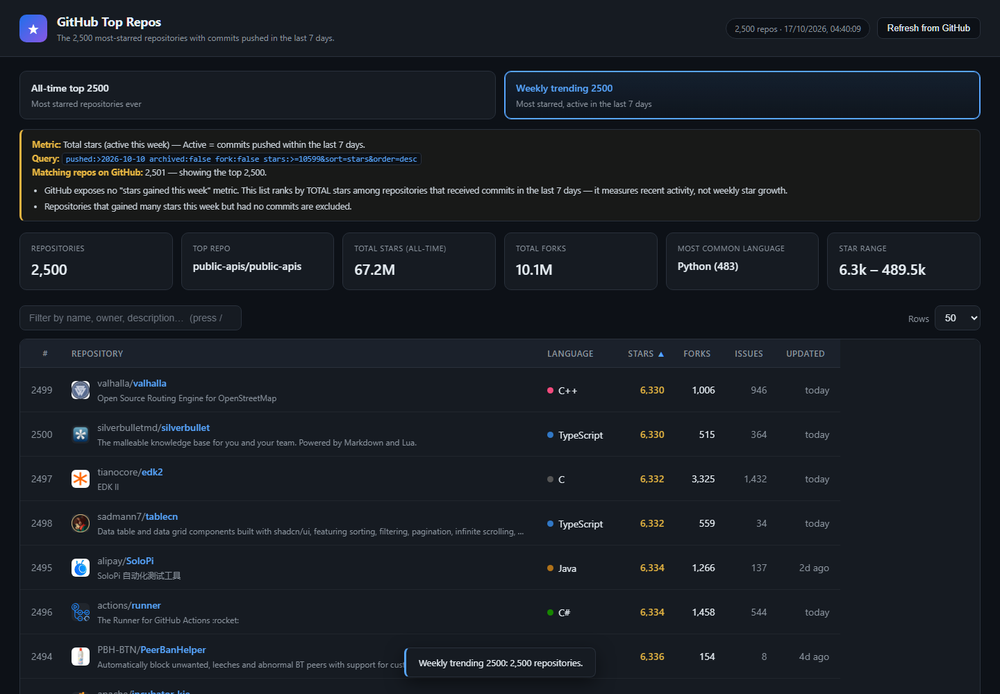

# GitHub Top Repos

A web app listing the **2,500 most starred repositories on GitHub**, in two switchable views,
built on the [`GET /search/repositories`](https://skmtc.dev/github/apis/rest/docs/search/repositories/get) endpoint.

Zero runtime dependencies — no build step. Requires Node 18+ (uses the built-in `fetch`).



## The two filters

| Filter | What it lists | Base query |
|---|---|---|
| **All-time top 2500** | The 2,500 most-starred repos ever | *(none — ranked by stars)* |
| **Weekly trending 2500** | The 2,500 most-starred repos with commits pushed in the last 7 days | `pushed:>YYYY-MM-DD archived:false fork:false` |

### ⚠️ What "weekly trending" honestly means

**GitHub's REST API has no trending endpoint and does not expose "stars gained in a period."**
There is no query that returns weekly star velocity. So the weekly filter measures something
real and checkable instead:

> **Recent activity** — repositories that received commits in the last 7 days — still ranked by
> **total** stars.

This is the same signal GitHub's own Trending page surfaces, and it is disclosed in the UI rather
than hidden behind a misleading label. The app shows the active metric, the exact query, and
these caveats directly above the table:

- GitHub exposes no "stars gained this week" metric. This list ranks by TOTAL stars among
  repositories that received commits in the last 7 days — it measures recent activity, not
  weekly star growth.
- Repositories that gained many stars this week but had no commits are excluded.

The total-stars stat card is labelled **"Total stars (all-time)"** in the weekly view so a
reader cannot mistake it for stars gained this week.

#### Why not "repos created this week"?

That was evaluated and rejected on evidence. Probing the API on 2026-10-15:

- `created:>7-days-ago` returns **2,685,191** repos, but only **11** of them have more than
  1,000 stars.
- A top-2500 list built that way would be almost entirely near-zero-star spam.
- Ranking newly-created repos by stars also reports *total* lifetime stars, so it is not
  a velocity metric either.

The activity-based query yields **16,097** candidates at 1,000+ stars — enough to fill a real top 2500.

## Reaching 2500 — star-band pagination

**GitHub caps *every* search query at 1,000 results.** Page 11 returns HTTP 422 regardless of
`total_count`; this is a documented hard limit, not a rate limit. Verified directly:

```
page 10 : items=100  total=5647
page 11 : ERROR 422 Unprocessable Entity
```

A single query therefore can never produce 2,500 repos. To go deeper, `fetch.js` splits the
result space into **star bands**, each holding ≤ 1,000 repos, and pages inside each band:

```
step 1: locate the star floor covering the requested depth   (binary search)
step 2: plan bands, each <= 1000 repos                       (binary search per band)
step 3: page through every band, stitch in descending star order
```

A real all-time 2500 run planned exactly three contiguous bands:

```
stars>=18772       ~1000 repos
stars:14647..18771 ~1000 repos
stars:12071..14646 ~1000 repos
```

Bands tile the star range with no gaps or overlaps, so the stitched result is the same list a
single unbounded query would have returned. `fetch.js` guards this by asserting it never emits
two `stars:` qualifiers in one query — GitHub silently ignores the second, which would make a
band return the entire result set.

Use `--dry-run` to inspect band planning without crawling:

```bash
node fetch.js --dataset all-time --depth 2500 --dry-run
```

## Quick start

```bash
node server.js          # or: npm start
```

Then open **http://127.0.0.1:3000**.

Both snapshots ship pre-fetched (`data/repos.json`, `data/trending.json`, ~1.7 MB each), so the
app works immediately with no network calls.

## Rate limits

Unauthenticated search allows **10 requests/minute**; a 2500-repo crawl needs ~35, so an
unauthenticated run takes roughly 4–5 minutes. With a token the limit is **30/minute** and the
same crawl takes ~1.5 minutes:

```bash
GITHUB_TOKEN=ghp_xxx node fetch.js --dataset both
```

Any token with `public_repo` scope works; if you have the `gh` CLI logged in you can reuse its
token without creating a new one:

```bash
GITHUB_TOKEN=$(gh auth token) node fetch.js --dataset both
```

`fetch.js` reads `x-ratelimit-reset` and backs off automatically on HTTP 403/429 or 5xx, and
retries transient network failures (up to 6 attempts per request).

## Refreshing the data

Click **Refresh from GitHub** (re-crawls whichever filter is active), or run:

```bash
node fetch.js --dataset all-time   # -> data/repos.json
node fetch.js --dataset weekly     # -> data/trending.json
node fetch.js --dataset both       # -> both
node fetch.js --dataset weekly --depth 250   # smaller crawl
node fetch.js --dataset all-time --dry-run   # plan bands, crawl nothing
```

The server runs the crawl as a child process, so the crawl logic lives in exactly one
place. Concurrent refreshes of the same dataset are de-duplicated.

## API

| Route | Description |
|---|---|
| `GET /api/datasets` | Metadata for each filter (label, query, caveats, availability) |
| `GET /api/repos` | Cached snapshot (defaults to `all-time`) |
| `GET /api/repos?dataset=weekly` | Snapshot for a named dataset |
| `GET /api/repos?dataset=weekly&refresh=1` | Crawl GitHub, then return the fresh snapshot |
| `GET /api/status` | Per-dataset metadata + live GitHub rate-limit state |

Dataset keys are validated against a fixed allow-list, so an unknown value returns HTTP 400
and is never used to build a filesystem path.

## Features

- **Two dataset filters** with a disclosure banner stating the metric, query and caveats
- **Sortable columns** — stars, forks, issues, rank, name, language, last updated
  (click a header to toggle direction)
- **Instant filter** across name, owner, description, language and topics
- **Pagination** — 25/50/100/250 rows per page
- **Summary stat cards** per dataset
- **Sticky header** that stays pinned while the table scrolls
- **Responsive** — cards reflow and the table scrolls horizontally on narrow screens
- Switching datasets resets filters, sorting and paging, so view state cannot leak across views
- Press `/` to jump to the filter, `Esc` to clear it

## Files

```
github-top1000/
├── fetch.js               # banded crawl of both datasets via /search/repositories
├── server.js              # zero-dep HTTP server (static + API + refresh)
├── verify.js              # headless: sorting, filtering, pagination
├── verify-layout.js       # headless: sticky header, responsive layout
├── verify-datasets.js     # headless: filters, metric labelling, data integrity
├── data/repos.json        # all-time snapshot: 2500 repos (~1.7 MB)
├── data/trending.json     # weekly snapshot: 2500 repos (~1.7 MB)
└── public/
    ├── index.html
    ├── styles.css
    └── app.js
```

## Verification

`verify-datasets.js` asserts the guarantees above rather than assuming them — including that
every weekly repo really was pushed within 7 days, that ranks are contiguous, that no archived
repos or forks leak in, that unknown dataset keys are rejected, and that band boundaries lost
no repos. It needs `playwright-core` and a Chromium build:

```bash
npm install playwright-core@1.63.0   # matches the cached browser build
node verify-datasets.js
```

## Notes

- Snapshots are point-in-time. Star counts and ranks drift; hit Refresh to re-crawl.
- Some repos have no primary language detected by GitHub; they render as `—`.
- Rows-per-page tops out at 250 for readability — the full 2500 is reachable by paging or filtering.
- The rate limit applies to the *server's* IP. If you refresh often, set `GITHUB_TOKEN`.


